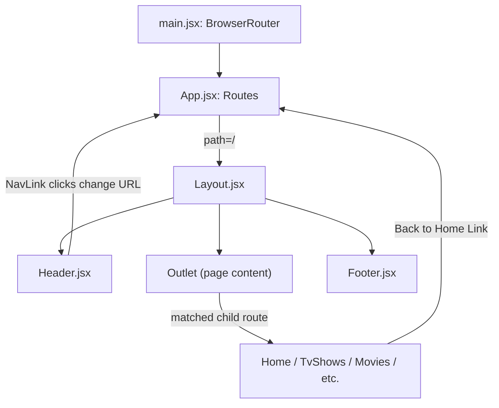

# Netflix Clone

A fully responsive Netflix-inspired streaming UI built with React and Vite, powered by the [TMDB API](https://www.themoviedb.org/documentation/api).

---

## Features

# Routing Flow



- **Dynamic Banner** — randomly selects a Netflix Original on every page load with a backdrop image, title, description, and action buttons
- **Multi-category movie rows** — Trending, Popular on Netflix, Top Rated, Action, Comedy, Horror, Romance, and Documentaries fetched in parallel
- **Swiper carousel** — smooth horizontal slide-show rows with hover-reveal navigation arrows and fully responsive breakpoints
- **Movie card hover preview** — expands on hover to show poster, match score, title, action buttons, metadata tags, and real genre names from TMDB
- **Scroll-aware header** — transparent gradient at top, solid dark background after 50px scroll, with backdrop blur
- **Expandable pill search** — search bar animates from icon to full pill input on click
- **Profile dropdown** — animated slide-down menu
- **Mobile hamburger nav** — full-screen drawer navigation on small screens
- **Page routes** — Home, TV Shows, Movies, New & Popular, My List, Browse by Languages, 404
- **Loading & error states** — Netflix-red spinner while fetching, user-facing error message on failure
- **Image fallback** — broken poster images gracefully replaced with a placeholder

---

## Tech Stack

| Layer | Technology |
|---|---|
| Framework | React 19 |
| Build tool | Vite 8 |
| Routing | React Router DOM 7 |
| HTTP client | Axios |
| Carousel | Swiper 14 |
| Icons | Lucide React + React Icons |
| Styling | CSS Modules |
| Linting | Oxlint |
| Data source | TMDB API v3 |

---

## Project Structure

```
src/
├── assets/image/          # Logo, banner fallback, and movie images
├── Components/
│   ├── Banner/            # Hero banner with random Netflix Original
│   ├── DetailModal/       # Movie info popup with synopsis & recommendations
│   ├── DisplayRow/        # Parallel-fetches all categories, renders SlideShow rows
│   ├── Footer/            # Social links, footer navigation, copyright
│   ├── Header/            # Fixed nav with search, notifications, profile dropdown
│   ├── Layout/            # Shell: Header + Outlet + Footer
│   ├── MovieCard/         # Poster card with hover preview, dynamic genres & match score
│   ├── SlideShow/         # Swiper carousel wrapper
│   └── TrailerModal/      # Live YouTube video trailer popup
├── context/
│   └── MovieContext.jsx   # Global state for My List, Modals, Search, & Profiles
├── Data/
│   └── Data.js            # Static movie data reference & offline fallback
├── pages/
│   ├── Home/              # Banner + all movie category rows
│   ├── TvShows/           # TV Series banner + genre filter + TV rows
│   ├── Movies/            # Movies banner + genre filter + movie rows
│   ├── NewsAndPopular/    # Top 10 Today + Fresh Releases + Worth the Wait
│   ├── MyList/            # Watchlist with localStorage sync, filters & sorting
│   ├── BrowseByLanguage/  # Multi-language discovery (Korean, Spanish, Hindi, etc.)
│   └── NotFound/          # 404 page
└── Utility/
    ├── MovieInstance.js   # Axios instance with TMDB base URL and API key
    └── requestUrls.js     # All TMDB endpoint paths
```

---

## Getting Started

### Prerequisites

- Node.js 18+
- A free [TMDB API key](https://www.themoviedb.org/settings/api)

### Installation

```bash
# 1. Clone the repository
git clone <your-repo-url>
cd movie-netflix-clone

# 2. Install dependencies
npm install

# 3. Set up environment variables
cp .env.example .env
# Edit .env and add your TMDB API key:
# VITE_TMDB_API_KEY=your_api_key_here

# 4. Start the dev server
npm run dev
```

Open [http://localhost:5173](http://localhost:5173) in your browser.

### Available Scripts

| Script | Description |
|---|---|
| `npm run dev` | Start development server with HMR |
| `npm run build` | Build for production |
| `npm run preview` | Preview the production build locally |
| `npm run lint` | Run Oxlint |

---

## Environment Variables

Create a `.env` file in the project root:

```env
VITE_TMDB_API_KEY=your_tmdb_api_key_here
VITE_API_KEY=your_tmdb_api_key_here
```

> The `.env` file is git-ignored. See `.env.example` for the required variable name.

---

## API

All data is fetched from the [TMDB API v3](https://api.themoviedb.org/3). The following endpoints are used:

| Category | Endpoint |
|---|---|
| Trending | `/trending/all/week` |
| Netflix Originals | `/discover/tv?with_networks=213` |
| Top Rated | `/movie/top_rated` |
| Action | `/discover/movie?with_genres=28` |
| Comedy | `/discover/movie?with_genres=35` |
| Horror | `/discover/movie?with_genres=27` |
| Romance | `/discover/movie?with_genres=10749` |
| Documentaries | `/discover/movie?with_genres=99` |

The API key and `language=en-US` are automatically attached to every request via the shared Axios instance in `src/Utility/MovieInstance.js`.

---

## Team

| Task | Member |
|---|---|
| T-01 Project Scaffolding | Group |
| T-02 Asset Organization | Group |
| T-03 TMDB API Setup | Group |
| T-04 Axios Instance & Endpoints | Yonatan |
| T-05 Global Styles | Yonatan |
| T-06 Router & Layout | Mo |
| T-07 Header Scroll Behaviour | Ferdos |
| T-08 Search, Notifications & Profile | Ferdos |
| T-09 Footer | Mo |
| T-10 Banner Data Fetching | Sadik |
| T-11 Banner UI | Sadik |
| T-12 Parallel Category Fetching | Mussa / Israal |
| T-13 Swiper Carousel | Mussa / Israal |
| T-14 MovieCard Hover Preview | Mussa / Israal |
| T-15 Responsive Layout & Mobile Nav | Eyob |
| T-16 CSS Audit & Animation Polish | Eyob |

---

## License

This project is for educational purposes only. All movie data and images are provided by [TMDB](https://www.themoviedb.org/). Netflix name and branding are trademarks of Netflix, Inc.
