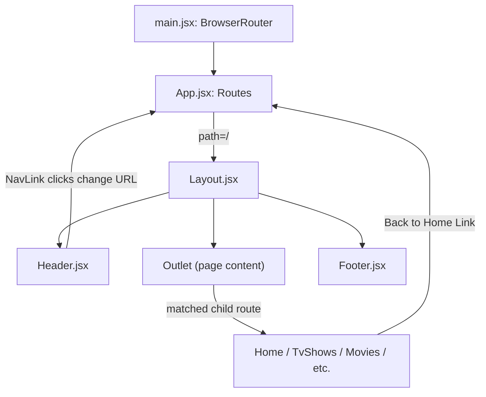

# Routing Flow & Architecture Guide

## Routing Flow

---

## 🧭 Routing Structure

- **`main.jsx`**: Initializes `<BrowserRouter>` to enable client-side navigation.
- **`App.jsx`**: Contains top-level `<Routes>` wrapped with global `<MovieProvider>` context.
- **`Layout.jsx`**: Acts as the master wrapper layout for all child routes:
  - **`<Header />`**: Fixed top navbar with Netflix logo, navigation links (`/`, `/tv-shows`, `/movies`, `/news-and-popular`, `/my-list`, `/browse-by-language`), real-time live search, notifications menu, and user profiles.
  - **`<Outlet />`**: Dynamically renders the active page view based on the current URL.
  - **`<Footer />`**: Bottom footer with social links, information columns, and service code generator.
  - **`<TrailerModal />` & `<DetailModal />`**: Global popup dialogs triggered from anywhere in the application.
  - **`<Toast />`**: Floating status notification for watchlist actions.

---

## 📄 Child Route Map

| Path | Component | Description |
|---|---|---|
| `/` | `Home.jsx` | Dynamic hero banner + 10 categorized movie & TV carousels |
| `/tv-shows` | `TvShows.jsx` | TV Series hero + Genre filter dropdown + TV rows |
| `/movies` | `Movies.jsx` | Movies hero + Genre filter dropdown + Blockbuster rows |
| `/news-and-popular` | `NewsAndPopular.jsx` | Top 10 Today + Fresh Releases + Worth the Wait upcoming schedule |
| `/my-list` | `MyList.jsx` | LocalStorage persistent watchlist + Filter & Sort controls |
| `/browse-by-language` | `BrowseByLanguage.jsx` | Multi-language catalog (Korean, Spanish, Japanese, Hindi, etc.) |
| `*` | `NotFound.jsx` | Authentic Netflix 404 error page (NSES-404) with redirect to Home |

---

## 📊 Visual Diagram

View [`routingDiagram.svg`](./routingDiagram.svg) for the full architectural visual map.
